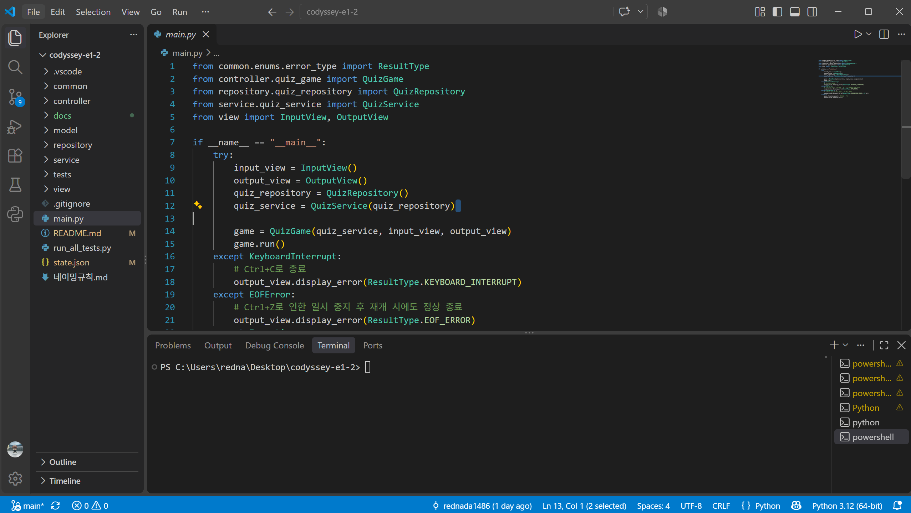
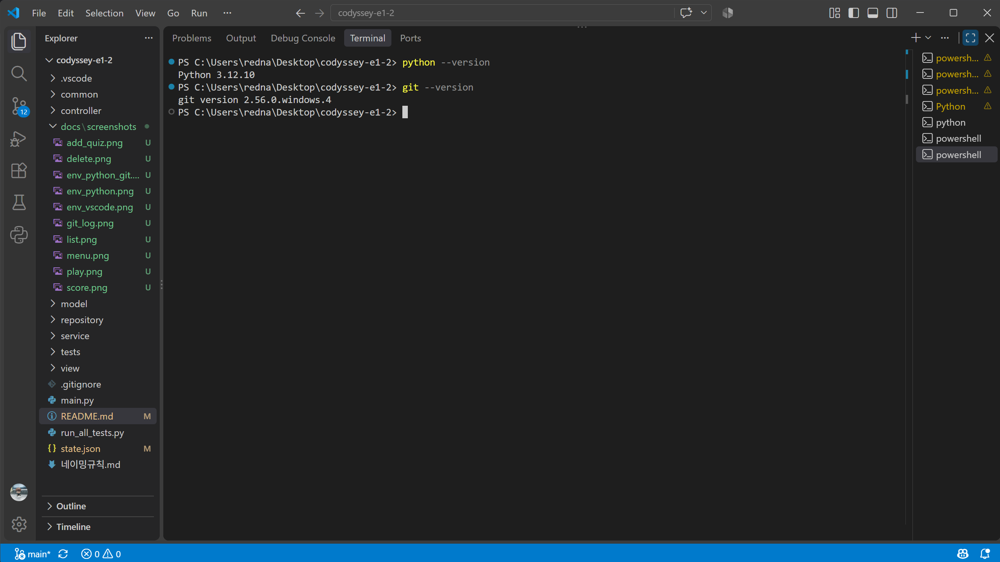
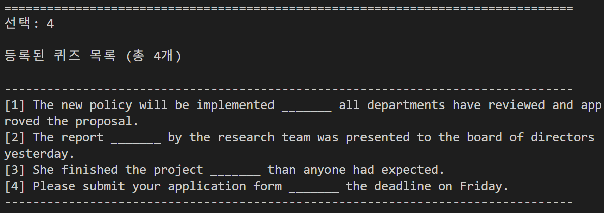
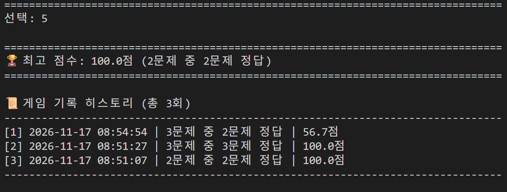
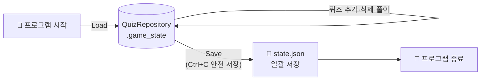

<div align="center">

# 🎯 TOEIC Part 5 문법 오답노트 CLI 퀴즈 게임

**Python 표준 라이브러리만으로 구현한 터미널 기반 토익 문법 학습 및 오답 관리 프로그램**


-success?style=flat-square)


</div>

---

## 📌 1. 프로젝트 개요

> **"문법을 아는 것과, 동작하는 하나의 프로그램을 완성하는 것은 다릅니다."**  
> 객체지향 계층 설계와 로컬 JSON 데이터 영속성을 결합한 **CLI 기반 토익 Part 5 학습 도구**입니다.

* **계층형 객체지향 설계**: `Controller - Service - Repository - Model - View`로 책임을 엄격히 분리해 유지보수성과 테스트 용이성을 확보했습니다.
* **무중단 데이터 영속성**: `QuizRepository`가 실행 중 상태를 메모리(`game_state`)에 보관하고, 종료 시 `state.json`에 일괄 저장합니다.
* **견고한 예외 처리**: 잘못된 입력, 파일 손상, `Ctrl+C` 강제 종료 상황에서도 비정상 종료 없이 데이터를 안전하게 보호합니다.

---

## 💡 2. 퀴즈 주제 선정 이유

| 핵심 배경 | 상세 내용 |
| :--- | :--- |
| **🎯 실용적인 개인 오답노트** | 실제 토익을 공부하며 자주 틀리는 문법 유형(가정법, 접속사, 분사, 비교급, 전치사 등)을 반복 학습할 도구가 필요했습니다. |
| **💸 상용 서비스 구독료 대체** | 월 수만 원대에 달하는 기존 AI 토익 학습 앱의 핵심 기능(문제 풀이·힌트·오답 복습)을 가볍게 직접 구현해 보고자 했습니다. |
| **🚀 추천 시스템으로의 확장** | 축적된 학습 이력(`histories`) 데이터를 분석해, 취약 문법 유형을 진단하고 맞춤 문제를 추천하는 알고리즘으로 발전시킬 계획입니다. |

---

## 🛠️ 3. 개발 환경 및 실행 방법

### 개발 환경
* **Language**: Python 3.10 이상 (표준 라이브러리만 사용)
* **IDE**: Visual Studio Code
* **Version Control**: Git / GitHub

> **🖥️ 개발 환경 설정 확인** (`VSCode` · `Python 버전` · `Git 설정`)

| VSCode 작업 환경 | Python 및 Git 설정 확인 |
| :---: | :---: |
|  |  |

### 설치 및 실행
```bash
# 1. 저장소 복제
git clone https://github.com/Genie1486/codyssey-e1-2.git
cd codyssey-e1-2

# 2. 프로그램 실행
python main.py
```

### 단위 테스트 실행
```bash
python run_all_tests.py
```

---

## ✨ 4. 기능 목록 및 실행 화면

### 기본 기능
| 기능 | 설명 |
| :--- | :--- |
| **📝 퀴즈 풀기** | 등록된 토익 Part 5 문법 문제를 풀고 즉시 정답/오답 여부 및 최종 점수를 확인합니다. |
| **➕ 퀴즈 추가** | 새로운 문제, 4개의 객관식 보기, 정답 번호, 문법 해설 힌트를 직접 등록합니다. |
| **📋 퀴즈 목록** | 현재 저장소에 등록된 전체 문제 목록을 한눈에 조회합니다. |
| **🏆 점수 확인** | 역대 최고 점수(`best_score`)와 누적 학습 기록(`histories`)을 조회합니다. |
| **🛡️ 입력 검증·복구** | 공백/빈 입력, 범위 초과, `KeyboardInterrupt(Ctrl+C)`, JSON 파싱 오류 시 안전하게 복구·처리합니다. |

### 확장(보너스) 기능
* **🎲 문제 수 선택 & 랜덤 출제**: 퀴즈 시작 전 원하는 출제 문항 수를 입력하면 문제를 무작위로 섞어 출제합니다.
* **💡 문법 힌트 & 점수 차감**: 풀이 중 `0`을 입력하면 문법 포인트를 힌트로 제공하며, 사용 횟수에 따라 점수가 차감됩니다.
* **🗑️ 퀴즈 삭제**: 등록된 문제 번호를 선택하고 확인 절차(`y/n`)를 거쳐 불필요한 문제를 삭제합니다.
* **📈 학습 히스토리 누적**: 매 플레이마다 완료 일시, 출제 수, 정답 수, 점수를 `histories`에 기록합니다.

### 📸 주요 기능 실행 화면
| 1. 메인 메뉴 | 2. 퀴즈 풀기 (힌트 및 채점) |
| :---: | :---: |
|  |  |

| 3. 퀴즈 추가 | 4. 퀴즈 목록 조회 |
| :---: | :---: |
|  |  |

| 5. 최고 점수 및 히스토리 확인 | 6. 퀴즈 삭제 |
| :---: | :---: |
|  |  |

---

## 📂 5. 파일 구조

```text
codyssey-e1-2/
├── common/                 # 공통 상수 및 Enum 정의
│   ├── constants/
│   └── enums/
├── controller/             # 사용자 입력 및 전체 흐름 제어
│   └── quiz_game.py        # QuizGame 컨트롤러 클래스
├── model/                  # 핵심 도메인 데이터 모델
│   ├── best_score.py       # 최고 점수 모델
│   ├── game_state.py       # 전체 게임 상태 모델
│   ├── quiz.py             # 개별 퀴즈 및 힌트 모델
│   └── score_history.py    # 플레이 이력 모델
├── repository/             # 파일 입출력 전담 계층
│   └── quiz_repository.py  # game_state 메모리 보관 및 종료 시 일괄 저장
├── service/                # 핵심 비즈니스 로직
│   └── quiz_service.py     # 점수 계산, 랜덤 추출, 정답 판별 등
├── view/                   # 콘솔 입출력 UI 분리
│   ├── input_view.py       # 사용자 입력 및 1차 유효성 검증
│   └── output_view.py      # 메뉴, 문제, 결과 화면 포맷팅 출력
├── tests/                  # 계층별 단위 테스트
│   ├── test_controller.py
│   ├── test_model.py
│   ├── test_service.py
│   └── test_view.py
├── docs/
│   └── screenshots/        # 개발환경, 실행화면, Git 로그 스크린샷
├── main.py                 # 애플리케이션 진입점
├── run_all_tests.py        # 전체 단위 테스트 실행기
├── state.json              # 영속 데이터 저장 파일 (UTF-8)
└── README.md
```

---

## 💾 6. 데이터 파일 설명 (`state.json`)

### 기본 정보 및 저장 생명주기
* **파일 경로**: `./state.json` (프로젝트 루트)
* **인코딩**: `UTF-8`



### 최상위 스키마 구조

| 키(Key) | 타입 | 설명 |
| :--- | :--- | :--- |
| `quizzes` | `list[dict]` | 등록된 토익 문법 퀴즈 객체 목록 |
| `best_score` | `dict` | 역대 최고 점수 기록 객체 |
| `histories` | `list[dict]` | 전체 퀴즈 플레이 이력 목록 |

<details>
<summary><b>🔍 하위 필드 상세 명세 보기 (클릭하여 펼치기)</b></summary>
<br>

#### 1) `quizzes` 항목 상세
| 필드명 | 타입 | 설명 |
| :--- | :--- | :--- |
| `id` | `int` | 퀴즈 고유 식별 번호 |
| `question` | `str` | 토익 Part 5 문법 문제 문장 |
| `choices` | `list[str]` | 4개의 객관식 보기 목록 |
| `answer` | `int` | 정답 번호 (`1` ~ `4`) |
| `hint` | `str` | 문법 해설 및 힌트 텍스트 |

#### 2) `best_score` & `histories` 항목 상세
| 필드명 | 타입 | 소속 | 설명 |
| :--- | :--- | :--- | :--- |
| `played_at` | `str` | `histories` | 플레이 완료 일시 (`YYYY-MM-DD HH:MM:SS`) |
| `total` | `int` | 공통 | 해당 회차에 출제된 총 문제 수 |
| `correct` | `int` | 공통 | 사용자가 맞힌 정답 문제 수 |
| `score` | `float` | 공통 | 최종 환산 점수 (힌트 감점 반영) |

</details>

---

## 🌿 7. Git 워크플로우 및 커밋 이력

기능 단위 커밋 컨벤션(`Feat`, `Fix`, `Refactor`, `Docs`, `Test`)과 브랜치 병합(`checkout`, `merge`), 원격 동기화(`clone`, `pull`) 워크플로우를 적용했습니다.

> **📊 `git log --oneline --graph` 실행 결과**  
> 