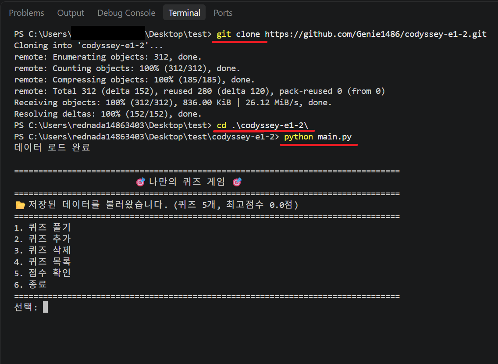
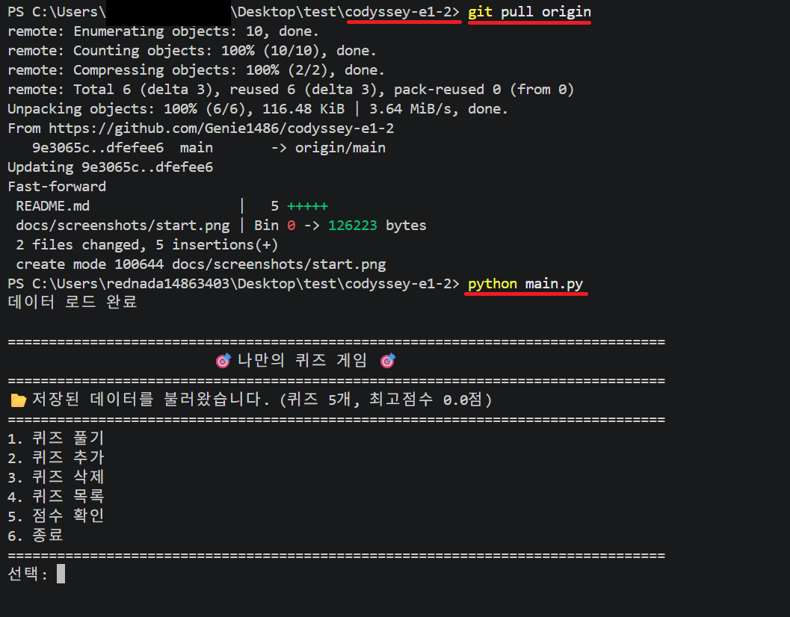
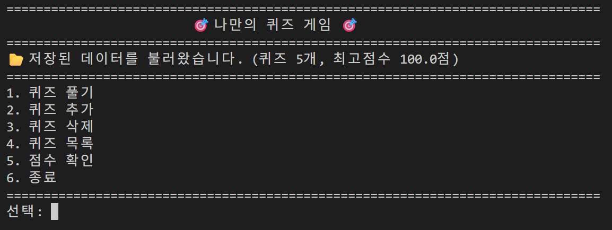
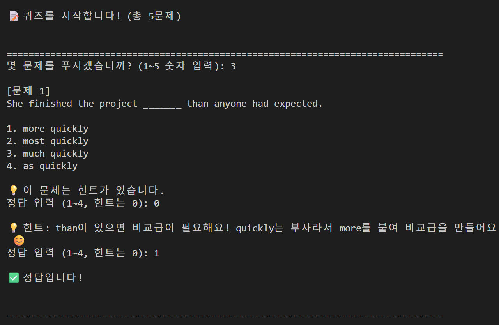
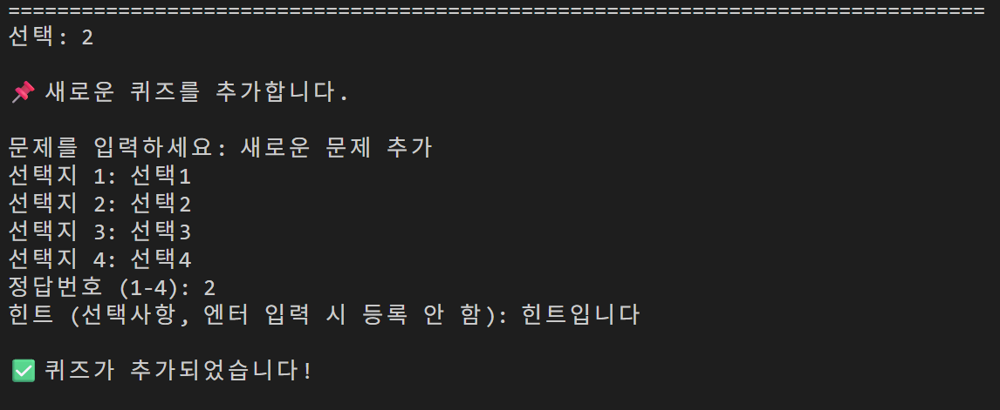
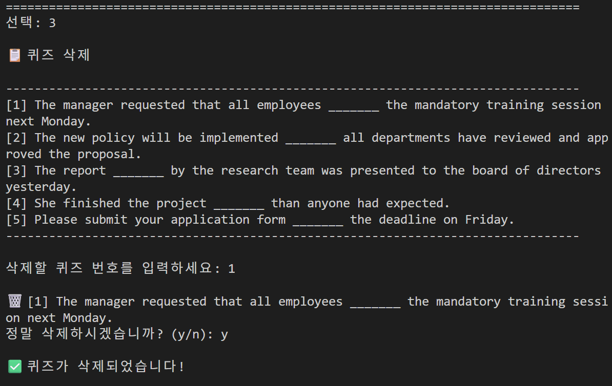
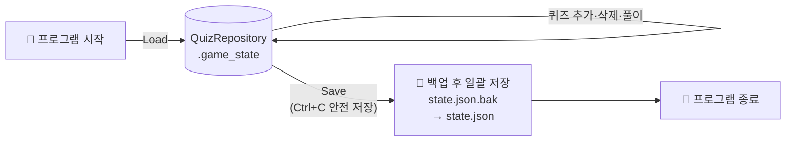
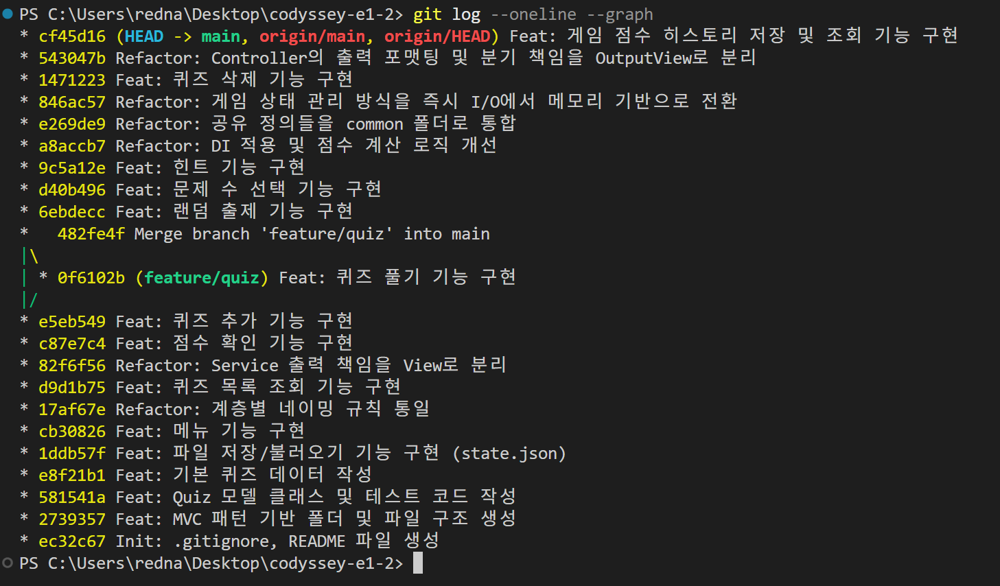

<div align="center">

# 🎯 TOEIC Part 5 문법 오답노트 CLI 퀴즈 게임

**Python 표준 라이브러리만으로 구현한 터미널 기반 토익 문법 학습 및 오답 관리 프로그램**


-success?style=flat-square)


</div>

---

## 📌 1. 프로젝트 개요

> **"문법을 아는 것과, 동작하는 하나의 프로그램을 완성하는 것은 다릅니다."**  
> 객체지향 계층 설계와 로컬 JSON 데이터 영속성을 결합한 **CLI 기반 토익 Part 5 학습 도구**입니다.

* **계층형 객체지향 설계**: `Controller - Service - Repository - Model - View`로 책임을 엄격히 분리해 유지보수성과 테스트 용이성을 확보했습니다.
* **무중단 데이터 영속성**: `QuizRepository`가 실행 중 상태를 메모리(`game_state`)에 보관하고, 종료 시 `state.json.bak` 백업 생성 후 `state.json`에 일괄 저장합니다.
* **견고한 예외 처리**: 잘못된 입력, 파일 손상, `Ctrl+C` 강제 종료 상황에서도 비정상 종료 없이 데이터를 안전하게 보호·복구합니다.

---

## 💡 2. 퀴즈 주제 선정 이유

| 핵심 배경 | 상세 내용 |
| :--- | :--- |
| **🎯 실용적인 개인 오답노트** | 실제 토익을 공부하며 자주 틀리는 문법 유형(가정법, 접속사, 분사, 비교급, 전치사 등)을 반복 학습할 도구가 필요했습니다. |
| **💸 상용 서비스 구독료 대체** | 월 수만 원대에 달하는 기존 AI 토익 학습 앱의 핵심 기능(문제 풀이·힌트·오답 복습)을 가볍게 직접 구현해 보고자 했습니다. |
| **🚀 추천 시스템으로의 확장** | 축적된 학습 이력(`histories`) 데이터를 분석해, 취약 문법 유형을 진단하고 맞춤 문제를 추천하는 알고리즘으로 발전시킬 계획입니다. |

---

## 🛠️ 3. 개발 환경 및 실행 방법

### 개발 환경
* **Language**: Python 3.10 이상 (표준 라이브러리만 사용)
* **IDE**: Visual Studio Code
* **Version Control**: Git / GitHub

> **🖥️ 개발 환경 설정 확인** (`VSCode` · `Python 버전` · `Git 설정`)

| VSCode 작업 환경 | Python 및 Git 설정 확인 |
| :---: | :---: |
|  |  |

### 설치 및 실행

#### 1. 최초 설치 및 실행
```bash
# 1. 저장소 복제
git clone https://github.com/Genie1486/codyssey-e1-2.git

# 2. 복제한 폴더로 이동
cd codyssey-e1-2

# 3. 프로그램 실행
python main.py
```
 


#### 2. 기존 사용자 업데이트(`git pull`)
이미 로컬에 저장소를 복제(clone)해 둔 경우, 최신 변경 사항(백업·복구 기능 등)을 반영하기 위해 아래 명령어로 동기화 후 실행합니다.
```bash
# 1. 프로젝트 폴더로 이동
cd codyssey-e1-2

# 2. 코드 변경 내용 받아오기
git pull origin main

# 3. 프로그램 실행
python main.py
```

 


### 단위 테스트 실행
```bash
# 1. 프로젝트 폴더로 이동
cd codyssey-e1-2

# 2. 테스트 실행
python run_all_tests.py
```


---

## ✨ 4. 기능 목록 및 실행 화면

### 기본 기능
| 기능 | 설명 |
| :--- | :--- |
| **📝 퀴즈 풀기** | 등록된 토익 Part 5 문법 문제를 풀고 즉시 정답/오답 여부 및 최종 점수를 확인합니다. |
| **➕ 퀴즈 추가** | 새로운 문제, 4개의 객관식 보기, 정답 번호, 문법 해설 힌트를 직접 등록합니다. |
| **📋 퀴즈 목록** | 현재 저장소에 등록된 전체 문제 목록을 한눈에 조회합니다. |
| **🏆 점수 확인** | 역대 최고 점수(`best_score`)와 누적 학습 기록(`histories`)을 조회합니다. |
| **🛡️ 입력 검증·복구** | 공백/빈 입력, 범위 초과, `KeyboardInterrupt(Ctrl+C)`, JSON 파싱 오류 시 백업 파일(`state.json.bak`)을 통해 안전하게 복구·처리합니다. |

### 확장(보너스) 기능
* **🎲 문제 수 선택 & 랜덤 출제**: 퀴즈 시작 전 원하는 출제 문항 수를 입력하면 문제를 무작위로 섞어 출제합니다.
* **💡 문법 힌트 & 점수 차감**: 풀이 중 `0`을 입력하면 문법 포인트를 힌트로 제공하며, 사용 횟수에 따라 점수가 차감됩니다.
* **🗑️ 퀴즈 삭제**: 등록된 문제 번호를 선택하고 확인 절차(`y/n`)를 거쳐 불필요한 문제를 삭제합니다.
* **📈 학습 히스토리 누적**: 매 플레이마다 완료 일시, 출제 수, 정답 수, 점수를 `histories`에 기록합니다.

### 📸 주요 기능 실행 화면

| 1. 메인 메뉴 | 2. 퀴즈 풀기 (힌트 및 채점) |
| :---: | :---: |
|  |  |

| 3. 퀴즈 추가 | 4. 퀴즈 목록 조회 |
| :---: | :---: |
|  |  |

| 5. 최고 점수 및 히스토리 확인 | 6. 퀴즈 삭제 |
| :---: | :---: |
|  |  |

---

## 📂 5. 파일 구조

```text
codyssey-e1-2/
├── common/                 # 공통 상수 및 Enum 정의
│   ├── constants/
│   └── enums/
├── controller/             # 사용자 입력 및 전체 흐름 제어
│   └── quiz_game.py        # QuizGame 컨트롤러 클래스
├── model/                  # 핵심 도메인 데이터 모델
│   ├── best_score.py       # 최고 점수 모델
│   ├── game_state.py       # 전체 게임 상태 모델
│   ├── quiz.py             # 개별 퀴즈 및 힌트 모델
│   └── score_history.py    # 플레이 이력 모델
├── repository/             # 파일 입출력 및 백업 전담 계층
│   └── quiz_repository.py  # game_state 메모리 보관, 백업 및 종료 시 일괄 저장
├── service/                # 핵심 비즈니스 로직 및 예외 복구
│   └── quiz_service.py     # 점수 계산, 랜덤 추출, 백업 기반 자동 복원 등
├── view/                   # 콘솔 입출력 UI 분리
│   ├── input_view.py       # 사용자 입력 및 1차 유효성 검증
│   └── output_view.py      # 메뉴, 문제, 결과 화면 포맷팅 출력
├── tests/                  # 계층별 단위 테스트
│   ├── test_controller.py
│   ├── test_model.py
│   ├── test_service.py
│   └── test_view.py
├── docs/
│   └── screenshots/        # 개발환경, 실행화면, Git 로그 스크린샷
├── main.py                 # 애플리케이션 진입점
├── run_all_tests.py        # 전체 단위 테스트 실행기
├── state.json              # 영속 데이터 저장 파일 (UTF-8)
├── state.json.bak          # 데이터 손상 대비 자동 백업 파일 (UTF-8)
└── README.md
```

---

## 🏗️ 6. 아키텍처 및 책임 분리 설계

### 1) 핵심 클래스 책임 경계 (`Quiz` vs `QuizGame`)
도메인 데이터를 표현하는 Model(`Quiz`)과 프로그램 전체 흐름을 조율하는 Controller(`QuizGame`)의 책임을 엄격히 분리했습니다.

| 구분 | `Quiz` (`model/quiz.py`) | `QuizGame` (`controller/quiz_game.py`) |
| :--- | :--- | :--- |
| **역할 계층** | **Model** (도메인 엔티티) | **Controller** (애플리케이션 흐름 제어) |
| **핵심 책임** | • 개별 퀴즈의 데이터(`id`, `question`, `choices`, `answer`, `hint`) 캡슐화<br>• 힌트 존재 여부 확인(`has_hint`) 및 JSON 직렬화/역직렬화(`to_dict`, `from_dict`) | • 프로그램 초기화(`_initialize_game`) 및 종료(`finalize_game`) 생명주기 관리<br>• 메뉴 선택에 따른 실행 흐름 분기(`_handle_menu`)<br>• `InputView`, `OutputView`, `QuizService` 간의 데이터 중계 |
| **제한 경계** | 콘솔 입출력(`input`/`print`), 점수 계산, 파일 저장에 일절 관여하지 않음 | 비즈니스 연산(점수 산출, 랜덤 추출)이나 파일 I/O를 직접 수행하지 않음 |

### 2) 역할별 파일·메서드 매핑 및 유지보수 가이드
기능 변경이나 버그 수정 시 어느 파일과 메서드를 수정해야 하는지 명확히 구분되도록 계층을 분리했습니다.

| 담당 역할 | 파일 경로 | 클래스 및 주요 메서드 | 수정이 필요한 경우 (변경 근거) |
| :--- | :--- | :--- | :--- |
| **입력 검증** | `view/input_view.py` | `InputView`<br>• `_validate_integer_input()`<br>• `get_menu_choice()`<br>• `get_quiz_input()` | 숫자 범위 제한, 빈 입력 처리, 사용자 프롬프트 문구 등 **입력 유효성 규칙**을 변경할 때 |
| **게임 진행<br>(흐름 제어)** | `controller/quiz_game.py` | `QuizGame`<br>• `_play_game()`<br>• `_play_quiz()`<br>• `_play_single_quiz()` | 메뉴 구성, 힌트 요청(`0`번 입력) 흐름, 문제 풀이 순서 등 **사용자 시나리오**를 변경할 때 |
| **비즈니스 로직<br>& 예외 복구** | `service/quiz_service.py` | `QuizService`<br>• `calculate_score()`<br>• `is_correct()`<br>• `get_quizzes_by_count()`<br>• `load_game_state()` / `_try_restore_from_backup()` | 힌트 감점 기준(`HINT_PENALTY = 10`), 정답 판별, 랜덤 추출, 파일 I/O 재시도 및 백업 복구 정책을 변경할 때 |
| **데이터 입출력<br>& 백업 관리** | `repository/quiz_repository.py` | `QuizRepository`<br>• `load_data()` / `load_backup_data()`<br>• `save_data()`<br>• `save_quiz()` / `delete_quiz()` | 저장 파일 경로(`state.json`, `state.json.bak`), JSON 직렬화 포맷, 인메모리(`game_state`) CRUD 방식을 변경할 때 |

---

## 💾 7. 데이터 파일 설명 및 백업·복구 정책 (`state.json`)

### 기본 정보 및 저장 생명주기
* **원본 데이터 경로**: `./state.json` (프로젝트 루트, `UTF-8`)
* **백업 데이터 경로**: `./state.json.bak` (프로젝트 루트, `UTF-8`)



### 백업 및 자동 복구 정책 (`state.json.bak`)
데이터 손실 및 파일 파싱 오류(`JSONDecodeError`)에 대비해 **2단계 자동 복구(Fallback) 메커니즘**을 적용했습니다.

1. **버전 백업 생성 (`QuizRepository.save_data`)**
   * 프로그램 종료 시 `state.json`을 덮어쓰기 직전, 기존 정상 파일을 `state.json.bak`으로 자동 복사(`shutil.copy2`)합니다.
2. **자동 복원 절차 (`QuizService.load_game_state`)**
   * **1차 복구 (백업 복원)**: 시작 시 `state.json`이 손상(`JSONDecodeError`)되었거나 유실(`FileNotFoundError`)된 경우, `state.json.bak`을 읽어 메모리(`game_state`)와 원본 `state.json`을 즉시 복구하고 사용자에게 복원 안내를 출력합니다.
   * **2차 복구 (기본값 초기화)**: 백업 파일마저 존재하지 않거나 손상된 경우, `DEFAULT_QUIZZES` 기본 토익 문법 데이터로 안전하게 초기화하여 프로그램 중단(Crash)을 방지합니다.

### 최상위 스키마 구조

| 키(Key) | 타입 | 설명 |
| :--- | :--- | :--- |
| `quizzes` | `list[dict]` | 등록된 토익 문법 퀴즈 객체 목록 |
| `best_score` | `dict` | 역대 최고 점수 기록 객체 |
| `histories` | `list[dict]` | 전체 퀴즈 플레이 이력 목록 |

<details>
<summary><b>🔍 하위 필드 상세 명세 보기 (클릭하여 펼치기)</b></summary>
<br>

#### 1) `quizzes` 항목 상세
| 필드명 | 타입 | 설명 |
| :--- | :--- | :--- |
| `id` | `int` | 퀴즈 고유 식별 번호 |
| `question` | `str` | 토익 Part 5 문법 문제 문장 |
| `choices` | `list[str]` | 4개의 객관식 보기 목록 |
| `answer` | `int` | 정답 번호 (`1` ~ `4`) |
| `hint` | `str` | 문법 해설 및 힌트 텍스트 |

#### 2) `best_score` & `histories` 항목 상세
| 필드명 | 타입 | 소속 | 설명 |
| :--- | :--- | :--- | :--- |
| `played_at` | `str` | `histories` | 플레이 완료 일시 (`YYYY-MM-DD HH:MM:SS`) |
| `total` | `int` | 공통 | 해당 회차에 출제된 총 문제 수 |
| `correct` | `int` | 공통 | 사용자가 맞힌 정답 문제 수 |
| `score` | `float` | 공통 | 최종 환산 점수 (힌트 감점 반영) |

</details>

---

## 📊 8. 대규모 데이터(1,000개 이상) 성능·메모리 분석 및 개선안

현재 프로그램은 소규모 개인 오답노트(수십~수백 문항)를 기준으로 전체 데이터를 `QuizRepository.game_state` 메모리에 적재하는 구조를 취하고 있습니다. 퀴즈 데이터가 **1,000개 이상**으로 증가할 경우의 병목 지점과 개선 대책은 다음과 같습니다.

### 1) 현재 구조의 병목 분석 (N ≥ 1,000 기준)
| 분석 항목 | 현재 방식 | 대규모 데이터 시 한계점 |
| :--- | :--- | :--- |
| **메모리 사용량** | 시작 시 `state.json` 전체를 파싱하여 `Quiz` 객체 리스트로 일괄 적재 (`O(N)`) | 문항 및 히스토리(`histories`) 누적 시 초기 로딩 지연 및 불필요한 RAM 점유 발생 |
| **검색 및 삭제 속도** | `delete_quiz()` 등에서 리스트 순회 기반 선형 탐색 (`O(N)`) | 특정 `id` 조회 및 삭제 대상 탐색 시 데이터 수에 비례해 연산량 증가 |
| **목록 출력 UX** | `display_quiz_list()`에서 전체 퀴즈를 콘솔에 한 번에 출력 | 터미널 버퍼 초과로 앞부분 문제가 잘려 가독성 저하 |
| **파일 쓰기 I/O** | 종료 시 `save_data()`로 전체 딕셔너리를 직렬화해 `state.json` 덮어쓰기 | 단 1문제만 수정해도 전체 파일을 재작성하는 쓰기 증폭(Write Amplification) 발생 |

### 2) 단계별 성능 개선 대책
1. **인덱싱(Indexing) 도입 (`O(N)` → `O(1)`)**
   * `QuizRepository` 내부에서 퀴즈 목록을 `list` 대신 `{quiz_id: Quiz}` 형태의 **해시 맵(Dict) 인덱스**로 관리하여 ID 기반 조회(`get_quiz_by_id`)·삭제(`delete_quiz`) 시간을 `O(1)`로 단축합니다.
2. **콘솔 페이지네이션(Pagination) 적용**
   * `OutputView.display_quiz_list()` 출력 시 한 페이지당 **10~20문항 단위**로 분할 출력(이전/다음 페이지 탐색)하여 렌더링 부하와 화면 스크롤 문제를 해소합니다.
3. **데이터 저장소 전환 및 지연 로딩(Lazy Loading)**
   * 문항 수가 수천 건을 넘어설 경우 단일 JSON 파일 대신 Python 내장 표준 라이브러리인 **`sqlite3`**로 저장소를 전환하여, 필요한 문항만 `LIMIT/OFFSET` 쿼리로 조회하고 변경된 레코드만 부분 업데이트(`INSERT`/`DELETE`)합니다.

---

## 🌿 9. Git 워크플로우 및 커밋 이력

기능 단위 커밋 컨벤션(`Feat`, `Fix`, `Refactor`, `Docs`, `Test`)과 브랜치 병합(`checkout`, `merge`), 원격 동기화(`clone`, `pull`) 워크플로우를 적용했습니다.
```bash
# git log --oneline --graph 텍스트 출력
# 커밋 개수 21개 (10개 이상)
# 482fe4f 커밋에서 feature/quiz 브랜치를 main으로 merge 함
git log --oneline --graph

* 5945eac (HEAD -> main, origin/main, origin/HEAD) Docs: README.md 작성
* cf45d16 Feat: 게임 점수 히스토리 저장 및 조회 기능 구현
* 543047b Refactor: Controller의 출력 포맷팅 및 분기 책임을 OutputView로 분리
* 1471223 Feat: 퀴즈 삭제 기능 구현
* 846ac57 Refactor: 게임 상태 관리 방식을 즉시 I/O에서 메모리 기반으로 전환
* e269de9 Refactor: 공유 정의들을 common 폴더로 통합
* a8accb7 Refactor: DI 적용 및 점수 계산 로직 개선
* 9c5a12e Feat: 힌트 기능 구현
* d40b496 Feat: 문제 수 선택 기능 구현
* 6ebdecc Feat: 랜덤 출제 기능 구현
*   482fe4f Merge branch 'feature/quiz' into main
|\  
| * 0f6102b (feature/quiz) Feat: 퀴즈 풀기 기능 구현
|/  
* e5eb549 Feat: 퀴즈 추가 기능 구현
* c87e7c4 Feat: 점수 확인 기능 구현
* 82f6f56 Refactor: Service 출력 책임을 View로 분리
* d9d1b75 Feat: 퀴즈 목록 조회 기능 구현
* 17af67e Refactor: 계층별 네이밍 규칙 통일
* cb30826 Feat: 메뉴 기능 구현
* 1ddb57f Feat: 파일 저장/불러오기 기능 구현 (state.json)
* e8f21b1 Feat: 기본 퀴즈 데이터 작성
* 581541a Feat: Quiz 모델 클래스 및 테스트 코드 작성
* 2739357 Feat: MVC 패턴 기반 폴더 및 파일 구조 생성
* ec32c67 Init: .gitignore, README 파일 생성
```

> **📊 `git log --oneline --graph` 실행 결과**  
> 
